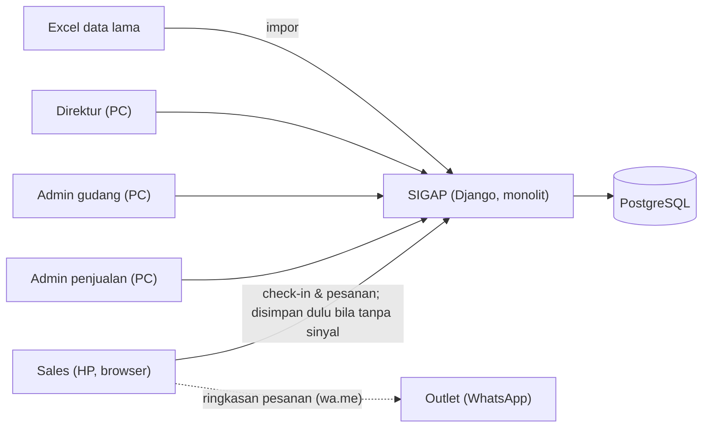

# Draf Solusi Gabungan ARB-02: SIGAP + ARBAIN CRM + ArbaSync

> Kembali ke: [README ARB-02](README.md) · [3 Ideate](03-ideate.md) · [Semua proyek](../README.md)
>
> **Status:** v0.4 gabungan · 19 Okt 2026 · menunggu kurasi tim
>
> **Dasar:**
> - **Fondasi:** SIGAP v0.3, yaitu P3 ([docx](../../referensi/ideas/Proposal_3_NamaTim_SIGAP.docx); folder kerja P3 sudah tidak ada di repo). Purwarupanya sudah dipindahkan ke Django + PostgreSQL di [purwarupa/](purwarupa/).
> - **Ditambah kelebihan** dari ARBAIN CRM, yaitu P1 ([docx](../../referensi/ideas/Proposal_1_ARBAIN_CRM_UMS_Hackathon_2026_Draft.docx)).
> - **Ditambah kelebihan** dari ArbaSync, yaitu P2 ([pdf](../../referensi/ideas/Proposal_2_AntechAsync_ArbaSync.pdf)).
>
> **Penanda:** `[asumsi]` = belum dikonfirmasi mitra · `[target]` = hasil yang ingin dicapai · `[pilih]` = keputusan tim

---

## 0. Prinsip

Prinsip SIGAP tetap berlaku: satu aplikasi web (HP untuk sales, PC untuk kantor), tanpa layanan berbayar, tanpa AI, dan tanpa akuntansi. Ada satu aturan tambahan untuk memilih fitur dari P1 dan P2. Sebuah fitur hanya diambil jika memenuhi kedua syarat ini:

1. langsung menaikkan indikator mitra atau aspek penilaian yang lemah di SIGAP (tema kesehatan, inovasi, akurasi stok);
2. biayanya kecil, yaitu paling banyak **2 tabel baru dan 1 layar baru**, tanpa teknologi baru.

## 1. Ide dalam satu paragraf

Sales membuka SIGAP di HP dan melihat **Kunjungan hari ini**, yaitu daftar outlet yang sudah diurutkan beserta alasannya: jatuh tempo, waktunya order, atau lama tidak dikunjungi. Sales check-in, menekan **Ulangi pesanan terakhir**, lalu **Kirim**. Tanpa sinyal pun pesanan tersimpan di HP dan terkirim otomatis **tepat satu kali**.

Satu pesanan langsung melakukan tiga hal tanpa input ulang:
- mengurangi **stok tersedia**;
- menambah **riwayat outlet**;
- menambah **capaian target**.

**Stok fisik** baru berkurang saat gudang mengirim barang, sehingga hasil stock opname tetap jujur. Gudang mencatat **batch dan tanggal kedaluwarsa**. Saat kirim, sistem memakai **batch tertua lebih dulu (FEFO)** dan mencatat outlet penerima setiap batch.

Direktur melihat tiga laporan, ditambah daftar stok menipis dan daftar barang mendekati kedaluwarsa.

## 2. Yang diambil, dan yang sengaja tidak diambil

### 2.1 Dipertahankan dari SIGAP (fondasi)

- Satu aplikasi web dengan panel admin dan dashboard bawaan. *(Stack SIGAP semula Laravel + Filament + MySQL. Per 19 Okt 2026 diganti menjadi **Django + PostgreSQL**, monolit; lihat §11.)*
- Layar sales berbasis web dengan antrean IndexedDB (Dexie.js) dan kode unik `client_uuid`.
- Check-in GPS, "Ulangi pesanan terakhir", dan peringatan stok menipis.
- Jatuh tempo dengan status bayar, tanpa akuntansi.
- Impor Excel dengan cek duplikat lewat nomor HP.
- Riwayat mutasi, form penyesuaian stok (opname), dan tombol `wa.me`.
- Purwarupa P3 (PHP + SQLite, 12/12 uji) sebagai titik awal, kini diganti purwarupa Django + PostgreSQL (22/22 uji, §11); serta 54 tanya-jawab juri.

### 2.2 Diambil dari P1 dan P2

| Asal | Yang diambil | Mengapa | Biaya tambahan |
|---|---|---|---|
| **P1** | **Stok fisik dipisah dari stok dipesan.** Stok tersedia = fisik − dipesan | Memperbaiki cacat SIGAP. Tanpa pemisahan ini, opname memberi selisih palsu untuk barang yang sudah dipesan tetapi belum dikirim. Penyesuaian juga bisa "mengembalikan" stok yang sudah dijanjikan ke outlet, sehingga barang bisa terjual dua kali | 2 kolom, 1 tombol "Konfirmasi kirim" |
| **P1** | **Empat peran** sesuai brief: sales, admin penjualan, admin gudang, direktur | Brief menyebut keempatnya. Di SIGAP, admin penjualan dan admin gudang masih digabung | Grup dan izin bawaan Django |
| **P1** | **Jejak status pesanan**: siapa dan kapan dikirim, dibatalkan (dengan alasan), dilunasi | Setiap pesanan bisa ditelusuri | Beberapa kolom di `pesanan` |
| **P1** | **Uji konkurensi**: dua pesanan bersamaan tidak membuat stok minus | Kriteria uji yang terukur | Satu skenario uji |
| **P2** | **Batch dan tanggal kedaluwarsa** saat barang masuk, **FEFO otomatis** saat kirim, **telusur batch → outlet penerima**, daftar **mendekati kedaluwarsa** | Pembeda kesehatan terkuat: keamanan produk, kesiapan penarikan produk, praktik CPOTB. Menutup kelemahan SIGAP di aspek tema (22%) | 2 tabel, 1 layar |
| **P2** | **Kunjungan hari ini** berprioritas, dengan **alasan yang terlihat** | Meningkatkan penanda "Waktunya order" SIGAP menjadi alat kerja sales. Menjawab "jadwal repeat order" di brief | Tanpa tabel baru; aturan pengurutan |
| **P2** | **Siklus order dari riwayat**: median selang 5 pesanan terakhir; jika belum ada 3 pesanan, pakai bawaan 14 hari | Statistik sederhana yang mudah dijelaskan ke juri dan sales | 1 kolom di `outlet` |
| **P2** | Label **"stok per jam sinkron"** dan jumlah pesanan yang menunggu sinyal | Sales tahu angka stok di HP mungkin sudah berubah | Tampilan saja |
| **P2** | **Skenario demo dua HP mode pesawat** memesan stok terakhir | Momen demo paling meyakinkan untuk keandalan dan konsistensi | Skenario |
| **P2** | Target evaluasi **SUS ≥ 70**, **≥ 90% tugas berhasil**, validasi **≥ 5 narasumber**; identitas tim Antech Async; pustaka akademik | Memperkuat proposal (aspek hilirisasi dan masalah–solusi) | Dokumen |

### 2.3 Sengaja tidak diambil

| Asal | Tidak diambil | Alasan | Ke mana |
|---|---|---|---|
| P1 | Persetujuan admin untuk **setiap** pesanan | Bertentangan dengan brief (stok terpotong saat pesanan dibuat) dan menambah langkah manual. Admin cukup menangani pengecualian (§5) | — |
| P1 | Angular + Rust + PostgreSQL | Berat untuk 3 hari dan sulit dirawat UMKM | — |
| P2 | **Jatah stok prediktif per sales** | Butuh riwayat nyata (mitra hanya memberi data dummy). Membagi stok per sales juga bisa membuat stok seolah habis karena tertahan di jatah sales lain | Peta jalan, setelah pilot |
| P2 | Exponential smoothing, saran jumlah produksi | Butuh data beberapa bulan | Peta jalan |
| P2 | PWA penuh (Workbox, Background Sync) dan React | Background Sync belum didukung semua browser. Cara SIGAP (event `online`, pengecekan 15 detik, tombol "Kirim sekarang") sudah teruji | Peta jalan |
| P2 | Tabel piutang, prospek WhatsApp/maklon | Melebarkan lingkup. Jatuh tempo + status bayar sudah cukup | Peta jalan (prospek → ARB-01) |
| P2 | Klaim "digabung dari banyak HP tanpa konflik" | Terlalu kuat. Konflik stok tetap mungkin terjadi; yang dijamin adalah **tidak ada pesanan ganda dan stok tidak pernah minus** | Diganti dengan klaim ini |

## 3. Indikator dan batasan mitra → fitur

| Indikator / batasan | Fitur |
|---|---|
| Terhubung real-time **tanpa input berulang** | Satu pesanan sales sekaligus mengubah stok tersedia, riwayat outlet, dan capaian target |
| Stok **terpotong saat pesanan dibuat** | Stok tersedia langsung berkurang saat pesanan diterima server |
| **Akurasi stok** meningkat | Stok fisik terpisah dari stok dipesan. Semua perubahan tercatat di mutasi. Opname membandingkan hitungan fisik dengan **stok fisik** |
| **Pemantauan kinerja** harian/bulanan | Dashboard direktur (3 laporan) |
| Input **dalam hitungan detik** | Kunjungan hari ini → check-in → ulangi pesanan → kirim (3–4 ketukan) |
| **Andal di jaringan seluler** | Antrean di HP, kirim otomatis, kode unik |
| **Tanpa akuntansi rumit** | Hanya jatuh tempo dan status bayar |
| Panduan dan **skema migrasi data** | Templat Excel, cek duplikat, panduan per peran |
| *(nilai tambah kesehatan)* | Nomor BPOM per produk; batch, kedaluwarsa, FEFO, telusur batch |

## 4. Fitur inti (tetap 5, isinya diperkaya)

1. **Data outlet terpusat dan impor Excel** *(SIGAP)*
   - Nomor HP dirapikan otomatis.
   - Nomor HP yang sama ditandai sebagai kemungkinan duplikat, lalu digabung admin penjualan.
2. **Aplikasi sales di HP** *(SIGAP + P2)*
   - **Kunjungan hari ini** berprioritas dengan alasan (§6).
   - Check-in GPS dan jam.
   - Ulangi pesanan terakhir.
   - Menampilkan **stok tersedia per jam sinkron**.
   - Pesanan tetap tersimpan saat tanpa sinyal.
3. **Stok dan gudang** *(SIGAP + P1 + P2)*
   - Stok fisik dan stok dipesan dipisah (§5).
   - Barang masuk dicatat per batch beserta tanggal kedaluwarsanya.
   - Konfirmasi kirim dengan FEFO otomatis.
   - Penyesuaian stok (opname) per batch.
   - Peringatan stok menipis.
   - Riwayat mutasi.
   - Telusur batch.
4. **Info pelanggan (outlet)** *(SIGAP)*
   - Riwayat pesanan dan kunjungan.
   - Jatuh tempo dan status bayar.
   - Siklus order (dihitung otomatis).
5. **Dashboard direktur** *(SIGAP + P2)*
   - Performa sales, outlet paling aktif, perputaran stok.
   - Daftar stok menipis.
   - Daftar **mendekati kedaluwarsa** (≤ 90 hari) `[pilih]`.

## 5. Aturan stok

Setiap produk punya dua angka: **stok fisik** (barang yang ada di gudang) dan **stok dipesan** (sudah dipesan, belum dikirim). Sales hanya melihat **stok tersedia = fisik − dipesan**.

| Kejadian | Oleh | Stok fisik | Stok dipesan | Stok tersedia | Batch |
|---|---|---|---|---|---|
| Barang masuk | Admin gudang | **+q** | — | +q | Batch baru: nomor, kedaluwarsa, jumlah |
| Pesanan diterima server (tersedia ≥ q) | Sales | — | **+q** | **−q** | — |
| Pesanan diterima server (tersedia < q) | Sales | Baris ditolak: "sisa stok tersedia X" | | | |
| Pesanan dibatalkan sebelum dikirim | Admin penjualan | — | −q | +q | — |
| **Konfirmasi kirim** | Admin gudang | **−q** | **−q** | tetap | Dikurangi dari batch dengan kedaluwarsa terdekat (FEFO); batch → outlet tercatat |
| Penyesuaian (opname) | Admin gudang | ± selisih | — | ± selisih | Batch dipilih (bawaan: batch tertua); alasan wajib |

Beberapa catatan:

- **Bandingkan dengan stok fisik.** Opname membandingkan hitungan fisik dengan **stok fisik**, bukan stok tersedia. Akibatnya, barang yang sudah dipesan tetapi masih di rak tidak menimbulkan selisih palsu.
- **Fisik bisa lebih kecil dari dipesan.** Ini terjadi misalnya karena ada barang rusak. Dashboard lalu menampilkan **"perlu perhatian"**, dan admin penjualan memutuskan apakah pesanan dikirim sebagian atau dibatalkan. Inilah satu-satunya peran "persetujuan" dari P1 yang dipakai, yaitu hanya untuk pengecualian.
- **Konkurensi.** Pesanan bersamaan tidak membuat stok minus, karena semua perubahan berjalan dalam satu transaksi (`transaction.atomic`) dengan penguncian baris produk (`select_for_update()` di PostgreSQL).
- **Pencatatan.** Setiap baris di atas menulis satu catatan `mutasi_stok` yang berisi Δfisik, Δdipesan, siapa, kapan, referensi, dan alasan. Tabel ini **hanya ditambah, tidak pernah diubah**, sehingga berfungsi sebagai buku besar mutasi ala P2.
- **Batas MVP.** Retur setelah kirim, banyak gudang, dan stok di mobil sales (kanvas) belum masuk MVP.

## 6. Kunjungan hari ini (prioritas dengan alasan)

Daftar outlet milik sales dikelompokkan berurutan. Tidak ada skor berbobot, supaya mudah dijelaskan:

| Urutan | Kelompok | Syarat | Label di HP |
|---|---|---|---|
| 1 | Jatuh tempo | Tagihan belum lunas dan jatuh tempo ≤ 3 hari lagi atau sudah lewat `[pilih]` | "Jatuh tempo 2 hari" |
| 2 | Waktunya order | Hari sejak order terakhir ≥ siklus order outlet | "Biasa order tiap 14 hari, sudah 16 hari" |
| 3 | Lama tidak dikunjungi | Lebih dari 30 hari tanpa kunjungan `[pilih]` | "21 hari tidak dikunjungi" |
| 4 | Lainnya | — | — |

Di dalam tiap kelompok, outlet yang paling lama terlambat ditaruh paling atas.

**Cara menghitung siklus order:**
- Siklus order = median selang 5 pesanan terakhir.
- Siklus diperbarui setiap ada pesanan baru, jadi tidak perlu job malam.
- Outlet dengan kurang dari 3 pesanan memakai bawaan 14 hari `[asumsi]`.

## 7. Saat sinyal hilang *(SIGAP, tetap)*

1. Pesanan disimpan dulu di HP (IndexedDB/Dexie) dengan kode unik.
2. Pesanan dikirim saat sinyal kembali: lewat event `online`, pengecekan tiap 15 detik, atau tombol **Kirim sekarang**.
3. Server menjawab "duplikat" untuk kode yang sama, sehingga pesanan tercatat **tepat sekali**.
4. **Data di HP baru dihapus setelah server menerima** *(P2)*.
5. **Stok tetap ditentukan server.** Jika stok tersedia ternyata kurang saat pesanan tiba, baris itu ditolak dan statusnya terlihat di "Pesanan saya". Sales lalu mengabari outlet.

**Syarat tanpa PWA (MVP).** Halaman sales harus **sudah terbuka saat masih ada sinyal**.

- **Pagi hari:** daftar outlet, produk, dan stok disimpan ke IndexedDB.
- **Selama tanpa sinyal:** semua layar sales tetap jalan, karena perpindahan layar terjadi di dalam satu halaman.
- **Yang tidak bisa:** membuka halaman dari nol atau me-*refresh* saat tanpa sinyal, karena browser menampilkan halaman "tidak ada koneksi". Antrean di IndexedDB tetap aman dan terkirim saat halaman dibuka lagi dengan sinyal.

Mitigasinya:
- peringatan sebelum halaman ditutup atau di-refresh bila masih ada pesanan di antrean;
- SOP: buka aplikasi pagi saat ada sinyal, jangan tutup tab;
- `navigator.storage.persist()`.

**Diputuskan 19 Okt 2026: tanpa PWA.** Service worker minimal (±30 baris, tanpa Workbox) dicatat sebagai pengembangan lanjutan, bila uji lapangan menunjukkan Android sering menutup tab di latar belakang.

## 8. Peran dan hak akses (4 peran)

| Peran | Boleh |
|---|---|
| Sales | Outlet miliknya saja; check-in; buat pesanan; melihat stok tersedia (tanpa mengubahnya) |
| Admin penjualan | Kelola outlet dan impor Excel; gabung duplikat; batalkan pesanan; ubah status bayar; tangani "perlu perhatian" |
| Admin gudang | Produk; barang masuk per batch; konfirmasi kirim; penyesuaian stok; telusur batch |
| Direktur | Dashboard dan semua laporan (baca saja); kelola pengguna dan target |

Dibuat dengan Django admin serta grup dan izin bawaan Django; menu tampil sesuai peran. Pembatasan "sales hanya melihat outletnya" diterapkan di kueri endpoint halaman sales.

## 9. Layar (9; SIGAP 8 + 1)

| No | Layar | Pengguna | Perubahan dari SIGAP |
|---|---|---|---|
| 1 | **Kunjungan hari ini**: capaian target + outlet berprioritas dengan label alasan | Sales (HP) | Diperkaya (P2) |
| 2 | Halaman outlet: check-in, 3 pesanan terakhir, jatuh tempo, tombol buat pesanan | Sales (HP) | Tetap |
| 3 | Form pesanan: ulangi pesanan terakhir, +/−, **stok tersedia per jam sinkron**, total, kirim | Sales (HP) | Label sinkron (P2) |
| 4 | Pesanan saya: menunggu sinyal / diterima / sebagian / ditolak; jumlah antrean | Sales (HP) | Tetap |
| 5 | Kelola outlet + impor Excel + kemungkinan duplikat | Admin penjualan | Tetap |
| 6 | Kelola pesanan: batal (alasan), status bayar, daftar "perlu perhatian" | Admin penjualan | Dipisah dari gudang (P1) |
| 7 | Produk dan stok: barang masuk per batch, fisik/dipesan/tersedia, penyesuaian, mutasi | Admin gudang | Batch + dua angka stok (P1, P2) |
| 8 | **Pengiriman dan telusur batch**: konfirmasi kirim (FEFO otomatis); cari nomor batch → daftar outlet penerima | Admin gudang | **Baru (P2)** |
| 9 | Dashboard direktur: 3 laporan + stok menipis + mendekati kedaluwarsa | Direktur | Ditambah daftar kedaluwarsa (P2) |

## 10. Data (10 tabel; SIGAP 8 + 2)

| Tabel | Kolom utama | Perubahan |
|---|---|---|
| `users` | nama, no. HP, **peran** (sales/admin_penjualan/admin_gudang/direktur) | Peran dipecah (P1) |
| `target` | sales, bulan, target omzet | Tetap |
| `outlet` | kode, nama, jenis, PIC, no. HP, alamat, lat/lng, sales, tempo (hari), **siklus_order_hari**, order_terakhir, kunjungan_terakhir | Siklus dihitung (P2) |
| `produk` | kode, nama, satuan, harga, no. BPOM, **stok_fisik**, **stok_dipesan**, stok_minimum | Dua angka stok (P1) |
| `batch` | produk, no_batch, **kedaluwarsa**, jumlah_masuk, **sisa**, tanggal_masuk | **Baru (P2)** |
| `kunjungan` | sales, outlet, waktu, lat/lng, hasil, catatan | Tetap |
| `pesanan` | kode unik dari HP, outlet, sales, kunjungan, status (baru/dikirim/batal), jatuh tempo, status bayar, dibuat_di_hp, diterima_server, **dikirim_oleh/pada**, **dibatalkan_oleh/alasan**, dilunasi_pada | Jejak status (P1) |
| `pesanan_item` | pesanan, produk, jumlah diminta, jumlah diterima, harga, keterangan | Tetap |
| `pengiriman_batch` | pesanan_item, batch, jumlah | **Baru (P2)**, dasar telusur batch |
| `mutasi_stok` | produk, batch, jenis (masuk/pesan/batal/kirim/penyesuaian), **Δfisik, Δdipesan**, fisik_sesudah, dipesan_sesudah, referensi, oleh, alasan, waktu | Dua kolom selisih (P1) |

## 11. Arsitektur dan teknologi *(SIGAP, tetap)*

| Bagian | Pilihan |
|---|---|
| Aplikasi dan panel | **Django** (monolit): Django admin untuk panel admin penjualan dan admin gudang; templat Django untuk dashboard direktur; impor Excel dengan pustaka seperti `django-import-export` `[pilih]` |
| Layar sales | **Satu halaman** templat Django + Alpine.js + Dexie (diambil dari purwarupa). Pindah layar terjadi di JavaScript tanpa memuat halaman baru; data lewat endpoint JSON Django. Halaman lain di aplikasi boleh memuat ulang biasa, karena hanya dipakai di PC yang online |
| Basis data | **PostgreSQL**, satu server; `transaction.atomic` + `select_for_update()` untuk stok |
| Hosting demo | VPS dengan HTTPS (GPS di browser HP butuh HTTPS) |

Satu aplikasi, satu basis data, tanpa layanan pihak ketiga.

**Purwarupa (19 Okt 2026):** [purwarupa/](purwarupa/) dibangun dengan Django 6.0 + PostgreSQL 16 dan menggantikan purwarupa PHP + SQLite dari P3. Isinya:
- stok fisik/dipesan/tersedia (§5), batch, dan FEFO;
- batal, opname, dan telusur batch;
- halaman sales satu halaman dengan Dexie.

Uji otomatis di Chrome: **22/22 lulus** ([bukti](purwarupa/bukti/hasil_uji.txt)). Sejak 20 Okt 2026 purwarupa juga punya **prediksi penjualan** (exponential smoothing Holt; riwayat 26 minggu data sintetis; WAPE model 23,0% vs naif 28,7% pada 4 minggu uji) beserta saran produksi. Yang belum dibuat: peran/hak akses, kunjungan hari ini, impor Excel, dan dashboard direktur lengkap.

## 12. Kebaruan dan kedalaman teknologi (bahan proposal)

**Kebaruan:**
- satu input sales memperbarui pelanggan, aktivitas, dan stok sekaligus;
- tetap andal tanpa sinyal;
- stok fisik dan stok dipesan dipisah, sehingga opname tetap jujur;
- batch dan kedaluwarsa bisa ditelusuri sampai ke outlet.

Semua itu ada dalam satu aplikasi ringan khusus distribusi produk herbal ke apotek dan minimarket, tidak dirangkai dari beberapa produk.

**Kedalaman teknologi** (semuanya bisa diperagakan):

1. **Sinkronisasi tanpa sinyal yang idempoten.** Memakai antrean di perangkat dan kode unik, mengacu pada konsep perangkat lunak *local-first* (Kleppmann dkk., 2019).
2. **Kendali konkurensi stok.** Reservasi dilakukan dalam satu transaksi dengan penguncian baris, sehingga stok tidak pernah minus.
3. **Buku besar mutasi** yang hanya ditambah. Setiap selisih bisa ditelusuri asal-usulnya.
4. **Ketertelusuran batch dengan FEFO.** Relevan dengan CPOTB (Peraturan BPOM 25/2021) dan penanganan keluhan atau penarikan produk.
5. **Siklus order dari median selang pesanan.** Statistik yang mudah dijelaskan, tanpa kotak hitam.

## 13. Beban kerja dan rencana bangun

Angka di bawah adalah perkiraan, belum divalidasi.

| Bagian | Asal | Hari-orang |
|---|---|---|
| Fondasi SIGAP (5 fitur, 8 layar). Simpan-tanpa-sinyal sudah ada di purwarupa | P3 | ±9–10 |
| Stok fisik vs dipesan + konfirmasi kirim | P1 | +1 |
| Empat peran | P1 | +0,5 |
| Batch, kedaluwarsa, FEFO, telusur batch | P2 | +1,5 |
| Kunjungan hari ini + siklus order | P2 | +0,5 |
| Uji konkurensi dan skenario dua HP | P1 + P2 | +0,5 |
| **Total** | | **±13–14** |

**Kapasitas tim (susunan P2):**
- Ada 3 orang yang membangun (Ridwan, Hammam, Reza), yaitu ±9 hari-orang selama hackathon.
- Dosen membimbing tanpa mengerjakan bagian mahasiswa, sesuai P2.

Akibatnya **±4–5 hari-orang harus selesai saat pembekalan (26 Okt–4 Nov)**.

**Sebelum hackathon (pembekalan):**
- Kerangka Django + PostgreSQL, 10 tabel (migrasi), 4 grup peran, dan hosting HTTPS.
- Aturan stok (§5) beserta ujinya.
- Kode Dexie dipindahkan dari purwarupa.
- Data contoh `[asumsi]`: ±100 outlet, 30 produk dengan 2–3 batch tiap produk, 3 sales, dan 3 bulan riwayat pesanan.

**Selama hackathon (3 hari):**

Pembagian peran mengikuti P2 `[pilih]`.

| Hari | Ridwan (backend, stok) | Reza (layar sales HP) | Hammam (panel admin, dashboard) | Purwo (aturan, uji, validasi) |
|---|---|---|---|---|
| 1 | Pesanan + reservasi + idempoten; batal | Kunjungan hari ini + halaman outlet + check-in | Kelola outlet + impor Excel + duplikat | Aturan batch/FEFO dan ambang; data contoh |
| 2 | Konfirmasi kirim + FEFO + penyesuaian per batch | Form pesanan + mode tanpa sinyal + pesanan saya | Produk/stok + pengiriman + telusur batch | Uji dua HP, uji konkurensi, uji opname |
| 3 | Siklus order, perapian, perbaikan bug | `wa.me`, perapian tampilan HP | Dashboard (3 laporan + menipis + kedaluwarsa) | Panduan pengguna dan migrasi, slide, video cadangan |

**Jika waktu mepet, potong dengan urutan ini:**
1. Layar telusur batch. Datanya tetap tercatat, dan bisa ditampilkan lewat kueri.
2. Siklus order otomatis. Pakai bawaan 14 hari saja.
3. Pemisahan admin penjualan dan admin gudang. Gabungkan jadi satu admin.

Yang **tidak boleh dipotong**: reservasi, mode tanpa sinyal, serta batch dan kedaluwarsa saat barang masuk.

## 14. Skenario demo (±4 menit)

1. **Impor Excel.** Dua outlet dengan nomor HP sama ditandai, lalu digabung.
2. **Barang masuk.** Satu produk masuk dalam 2 batch dengan tanggal kedaluwarsa berbeda.
3. **HP A.** Buka Kunjungan hari ini (perlihatkan label alasannya) → check-in → ulangi pesanan → kirim. Stopwatch ≤ 15 detik `[target]`. Stok tersedia turun, sedangkan stok fisik tetap.
4. **Dua HP dalam mode pesawat** sama-sama memesan stok terakhir. Sinyal dinyalakan: satu pesanan diterima, satu baris ditolak. Tekan "Kirim sekarang" lagi: pesanan tetap hanya satu.
5. **Admin gudang** mengonfirmasi kirim. FEFO memakai batch tertua, dan stok fisik turun.
6. **Opname** dilakukan saat masih ada pesanan yang belum dikirim. Tidak muncul selisih palsu. Penyesuaian "rusak −1" tercatat beserta alasannya.
7. **Telusur batch** → muncul daftar outlet penerima.
8. **Dashboard direktur.**

## 15. Kriteria uji

**Uji 1–12 dari purwarupa SIGAP tetap berlaku**, kecuali ada penyesuaian makna. Uji no. 8 dan 11 kini memeriksa **stok tersedia**.

Uji tambahan:

| No | Pemeriksaan | Asal |
|---|---|---|
| 13 | Pesanan diterima: stok tersedia turun, stok fisik tetap | P1 |
| 14 | Konfirmasi kirim: fisik dan dipesan turun; batch dengan kedaluwarsa terdekat terpakai lebih dulu | P1 + P2 |
| 15 | Batal sebelum kirim: stok dipesan kembali, fisik tetap | P1 |
| 16 | Opname saat ada pesanan belum dikirim: tidak ada selisih palsu | P1 |
| 17 | Dua pesanan bersamaan untuk stok terakhir: satu diterima, satu baris ditolak, stok tidak minus | P1 + P2 |
| 18 | Telusur batch menampilkan outlet penerima yang benar | P2 |
| 19 | Sales hanya melihat outletnya; admin gudang tidak bisa mengubah status bayar | P1 |
| 20 | Kunjungan hari ini menampilkan urutan dan alasan sesuai §6 | P2 |

**Uji pengguna setelah hackathon `[target]`:**
- input pesanan ulang ≤ 15 detik;
- SUS ≥ 70;
- ≥ 90% tugas inti berhasil;
- nol input berulang;
- selisih stok saat opname turun ≥ 50% dari nilai awal.

## 16. Peta jalan (setelah MVP)

| Tahap | Isi | Asal |
|---|---|---|
| Setelah pilot, ada data riwayat | Jatah stok per sales; uji akurasi prediksi penjualan pada data nyata (versi exponential smoothing + saran produksi sudah ada di purwarupa dengan data sintetis); model musiman/ML setelah data ≥ 1 tahun | P2 |
| Kebutuhan lapangan | PWA penuh, foto kunjungan, verifikasi radius check-in | P2, SIGAP |
| Kebutuhan mitra | Retur, banyak gudang, kanvas, ambang sisa umur per outlet | SIGAP v0.1 |
| Integrasi | Ekspor/konektor Accurate, WhatsApp resmi, data untuk agen AI ARB-01 | SIGAP v0.1 |

## 17. Dampak ke penilaian

Angka di bawah adalah perkiraan kami, bukan nilai resmi.

| Aspek (bobot) | SIGAP v0.3 | Gabungan | Sumber kenaikan |
|---|---|---|---|
| Masalah–solusi (20%) | Sedang–kuat | Kuat | Indikator akurasi stok kini benar-benar dijawab (§5); bukti masalah P2 (satu nomor WA tanpa basis data) |
| Tema kesehatan dan kedalaman teknologi (22%) | Lemah–sedang | **Sedang–kuat** | Batch, kedaluwarsa, FEFO, telusur batch (CPOTB); lima poin kedalaman (§12) |
| Inovasi dan kelayakan (28%) | Inovasi lemah, kelayakan kuat | Inovasi sedang, **kelayakan tetap kuat** | Pembeda kesehatan tanpa teknologi baru; purwarupa Django 22/22 |
| Hilirisasi dan dampak (20%) | Sedang | Sedang–kuat | Target SUS dan tugas, validasi ≥ 5 narasumber, tim lengkap (P2) |
| Fungsionalitas demo (25% ND) | Paling aman | Tetap aman | Tanpa pihak ketiga; skenario dua HP |

## 18. Bahan proposal

> **Sudah dibuat (19 Okt 2026):** [Proposal_AntechAsync_SIGAP.docx](Proposal_AntechAsync_SIGAP.docx) dan [pratinjau PDF](PRATINJAU_Proposal_AntechAsync_SIGAP.pdf).
> - Dibuat dari docx SIGAP (P3) yang berasal dari template resmi.
> - Isi dipadatkan agar muat: ringkasan 189 kata; bagian 1–4 di hlm 3–4 dan bagian 5–7 di hlm 5 (dicek dengan render Tahoma).
> - Pustaka Bisnis.com dan Espos dibuang untuk menghemat ruang.
> - Diagram baru ada di [lampiran/](lampiran/).
> - Sorotan kuning = data tim yang wajib diisi.
>
> Catatan di bawah adalah bahan penyusunannya.

**Dokumen dasar.**
- Pakai `Proposal_NamaTim_SIGAP.docx` (P3), karena formatnya sudah dicek dan Lampiran C.5 sudah terisi.
- Isi identitas tim dan bagian 5 dari P2.
- Dari P2, pindahkan juga tabel rencana kegiatan (ada ukuran keberhasilan per tahap) dan pustaka akademik yang relevan:
  - Kleppmann dkk. 2019 (*local-first*);
  - Peraturan BPOM 25/2021 (CPOTB);
  - Brooke 1996 (SUS).

**Judul** `[pilih]`:
- "SIGAP: Sistem Integrasi Gudang, Aktivitas Sales, dan Pelanggan dengan Pelacakan Batch untuk Distribusi Produk Herbal ke Apotek dan Minimarket"
- atau versi pendek: "SIGAP: CRM dan Stok Terpadu dengan Pelacakan Batch untuk Distribusi Produk Herbal"

**Draf ringkasan eksekutif (205 kata; batas 250):**

> CV Arba'in Jaya Mandiri, produsen dan distributor produk herbal terdaftar BPOM di Surakarta, memasok apotek dan minimarket melalui tim sales lapangan. Data pelanggan, kunjungan dan pesanan sales, serta stok belum terhubung, sehingga manajemen sulit memantau kinerja sales, riwayat pesanan tiap outlet, dan akurasi stok. Kami mengusulkan SIGAP, aplikasi web ringan yang menyatukan ketiganya. Sales membuka daftar kunjungan hari ini yang sudah diurutkan beserta alasannya, check-in, lalu mengulang pesanan terakhir dalam hitungan detik; bila sinyal hilang, pesanan tersimpan di ponsel dan terkirim otomatis tepat satu kali. Satu pesanan langsung mengurangi stok tersedia serta menambah riwayat outlet dan capaian target tanpa input ulang. Stok fisik baru berkurang saat gudang mengirim barang, sehingga hasil stock opname tetap akurat. Gudang mencatat batch dan tanggal kedaluwarsa, mengirim batch tertua lebih dulu, dan dapat menelusuri outlet penerima setiap batch untuk penanganan keluhan atau penarikan produk. Direktur memantau performa sales, outlet paling aktif, perputaran stok, serta stok menipis dan mendekati kedaluwarsa dari satu dashboard. Data lama dari Excel dipindahkan dengan templat impor dan pemeriksaan duplikat. Solusi berpotensi diadopsi UKM herbal dan jamu lain dengan model langganan berbiaya rendah. Kegiatan meliputi validasi alur bersama mitra, purwarupa saat hackathon, uji kegunaan, dan uji coba terbatas hingga April 2027. TKT awal 3, target TKT 6.

**Kondisi awal (jujur).**
- TKT 3: purwarupa Django–PostgreSQL lulus 22/22 uji (mode tanpa sinyal, kode unik, stok fisik/dipesan, FEFO, konkurensi, prediksi penjualan pada data sintetis; §11).
- **Belum dibuat:** pemisahan stok fisik/dipesan, batch, empat peran, kunjungan berprioritas, dan dashboard.
- Pilihannya:
  - perbarui purwarupa ke model stok §5 (±½ hari-orang), lalu jalankan ulang uji untuk bukti C.5;
  - atau tulis model §5 sebagai rancangan.

**Lampiran C.**
- C.1 arsitektur dengan 4 peran.
- C.2 alur pesanan → kirim (FEFO) → stok.
- C.3 layar (9).
- C.4 data (10 tabel).
- C.5 bukti uji.
- Tambahan opsional: wireframe HP dari P2 (C6), disesuaikan.

## 19. Yang perlu dikurasi

- [ ] **Orisinalitas:** pastikan purwarupa dan draf SIGAP dibuat oleh anggota tim (Ridwan). Kalau bukan, purwarupa tidak boleh dipakai sebagai bukti.
- [ ] Nama solusi: SIGAP (diusulkan, lebih mudah dipakai UKM lain) atau ArbaSync.
- [ ] Ambang "mendekati kedaluwarsa" (90 hari?), "jatuh tempo" (≤ 3 hari?), "lama tidak dikunjungi" (30 hari?).
- [ ] Siklus order bawaan (14 hari?).
- [ ] FEFO otomatis penuh, atau admin gudang boleh memilih batch lain.
- [ ] Perbarui purwarupa ke model stok §5 sebelum pengajuan, atau cukup ditulis sebagai rancangan.
- [ ] Pembagian peran §13.
