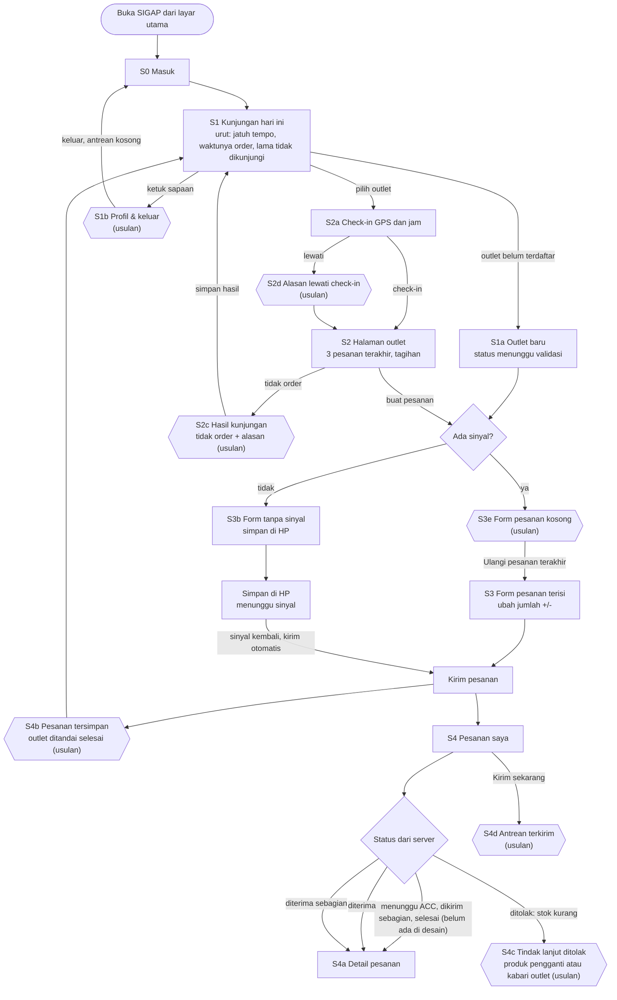
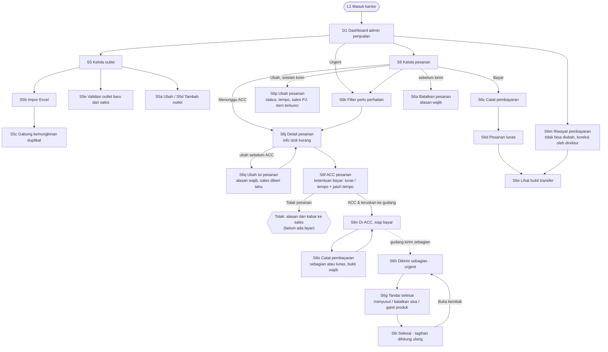
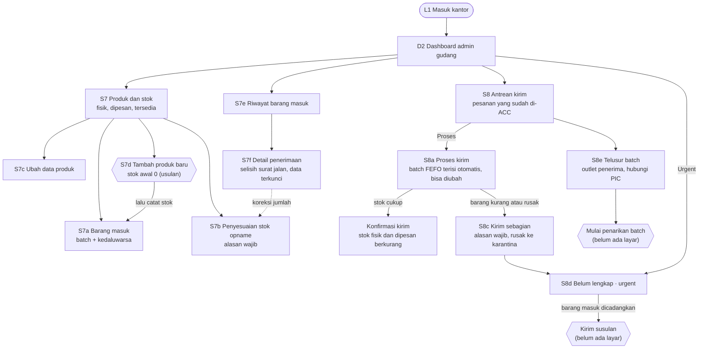
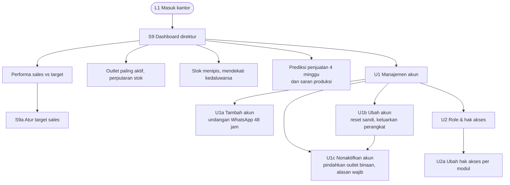
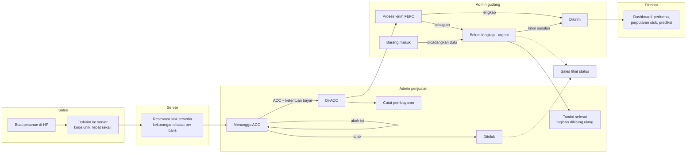

# User flow SIGAP (ARB-02)

Disusun dari [proposal v03](Proposal_AntechAsync_v03_SIGAP_2026-11-04.docx) (Tabel C.2, C.3) dan Figma "SIGAP · Hi-fi v2". Kode layar (S1, S2a, …) mengikuti nama frame di Figma. Langkah bertanda **(usulan)** sudah ditambahkan ke Figma sebagai layar S2c, S2d, S4b, S4c (4 Nov 2026), S3e, S7d, S4d, dan S1b (5 Nov 2026), tetapi belum ada di purwarupa; lihat [review-figma-hifi-v2.md](review-figma-hifi-v2.md).

Versi visual (5 diagram, dibuat dari kode di bawah lewat "Convert Mermaid code to diagram"): [FigJam — SIGAP User Flow (ARB-02)](https://www.figma.com/board/Dtii8Pg38TnDXi29melNsM/SIGAP-%E2%80%94-User-Flow--ARB-02-). Semua diagram dikonversi ulang 5 Nov 2026 malam (alur ACC, kirim sebagian, pembayaran, manajemen akun); urutan di board dari kiri: Sales, Admin penjualan, Admin gudang, Direktur, Lintas peran. Bila alur berubah, ubah kode di sini lalu konversi ulang di FigJam.

## 1. Sales (PWA di HP)

## 2. Admin penjualan

Diperbarui 5 Nov 2026 malam mengikuti Figma: pesanan dari HP kini **menunggu ACC** admin penjualan sebelum masuk antrean gudang.

## 3. Admin gudang

## 4. Direktur

## 5. Alur lintas peran: satu pesanan

Sisi sales (S4, S4a) belum menampilkan status baru "menunggu ACC", "dikirim sebagian", dan "selesai", serta notifikasi saat admin mengubah pesanan; lihat review.
