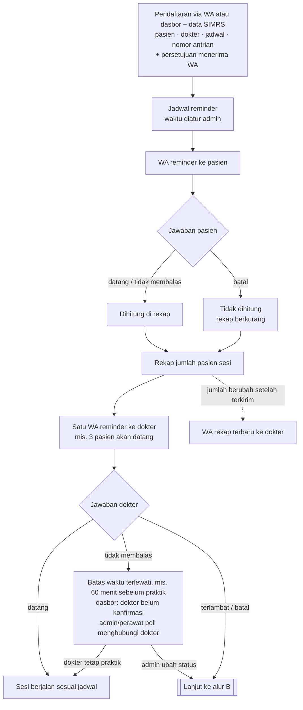
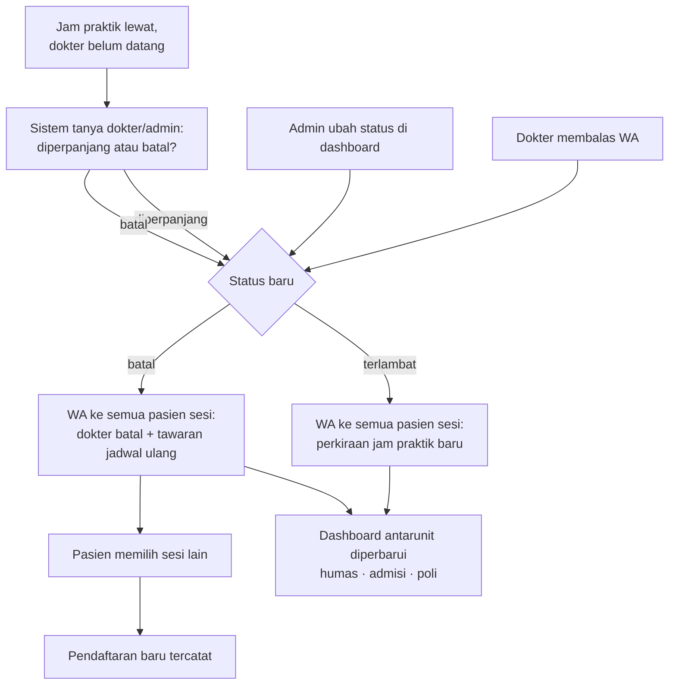

# Catatan Rapat 01 — Design Flow RS-01

> Transkripsi catatan tulisan tangan rapat tim ([referensi/Notes_RSUMS_01.pdf](../../referensi/Notes_RSUMS_01.pdf), 4 halaman). Tanggal rapat tidak tercantum di catatan.
> Kembali ke: [README RS-01](README.md) · [3 Ideate](03-ideate.md) · [Semua proyek](../README.md)
> Kata yang tidak terbaca jelas ditandai *[?]*; tafsiran ditulis di bagian [Catatan transkripsi](#catatan-transkripsi).

---

## 1. Catatan pembuka (halaman 1)

Catatan singkat tentang tantangan lain yang ikut disinggung dalam rapat:

- **DRPPS — hilirisasi** *[?: "cluster"]*
  - Dua sisi: **customer** (ditandai "?") dan **vendor**.
  - Vendor → **scrapping** — *[?: nama, terbaca "Pobby/Pebby"]*.
- **Arbain → CRM** (ARB-02).

Setelah itu catatan beralih ke **RS UMS**: **notifikasi → plan**.

## 2. Alur sistem (halaman 2–3)

### 2.1 Alur data

1. Pasien → **pendaftaran (lewat WhatsApp)** → **input sistem** (rekam medis)
2. → **Data dokter dan pasien (jadwal) terinput**
3. → **Nomor WA, jadwal, nomor antrian**
4. → **Sistem reminder ke dokter** *(custom)*

### 2.2 Diagram alur (diperbarui sesuai bagian 7)

Alur dibagi dua: **reminder terjadwal** dan **perubahan status dokter**.

**A. Reminder terjadwal dan rekap untuk dokter**

**B. Perubahan status dokter (target: WA terkirim < 1 menit)**

Ringkasan siapa memberi tahu siapa:

| Kejadian | Yang dikirim |
|---|---|
| Pasien konfirmasi datang atau tidak membalas | Dihitung di rekap untuk dokter |
| Pasien batal | Rekap berkurang; tidak ada pesan terpisah ke dokter |
| Rekap berubah setelah terkirim | Rekap terbaru ke dokter |
| Dokter terlambat | Ke semua pasien sesi: perkiraan jam baru |
| Dokter batal | Ke semua pasien sesi: pemberitahuan + tawaran jadwal ulang |

## 3. Aturan reminder dan konfirmasi (halaman 3)

- **Waktu pengiriman reminder bisa diatur oleh admin** (koreksi tim; di catatan tulisan tangan tertulis ½ jam sebelum praktek).
- **Reminder ke dokter tidak dikirim untuk setiap pasien.** Dokter cukup menerima satu reminder sebelum datang, berisi jumlah pasien yang akan datang (mis. "3 pasien akan datang") (koreksi tim).
- **Jika dokter batal, sistem memberi tahu pasien.** Jika pasien batal, dokter tidak dikirimi pesan terpisah; pembatalan cukup mengurangi jumlah pasien di rekap (koreksi tim; di catatan tulisan tangan tertulis "pihak yang batal diinformasikan ke pihak berlawanan").
- **Reminder dan *self distraction*** *[lihat catatan transkripsi]*, terdiri dari dua langkah:

| Langkah | Kapan | Isi | Hasil |
|---|---|---|---|
| Mengingatkan | Sebelum jadwal | Minta konfirmasi | **Ya atau tidak** |
| Konfirmasi lanjutan | **Setelah lewat jam praktek** | Minta konfirmasi | Konfirmasi ke sistem: **diperpanjang atau batal** |

- Pertanyaan terbuka: **"Apakah terintegrasi JKN?"**

## 4. Format pesan WhatsApp (halaman 4)

Tiga jenis pesan:

1. **Register** — konfirmasi pendaftaran
2. **Reminder** — pengingat jadwal
3. **Batal register** — pembatalan pendaftaran

## 5. Pengelompokan notifikasi (halaman 4)

- ~~**Grouping notifikasi:** buat **folder khusus untuk chat notifikasi** di smartphone pengguna, baik **dokter maupun pasien**.~~ *(dihapus, lihat bagian 7)*

## 6. Rangkuman rapat (halaman 4)

1. **Notifikasi blast WhatsApp** → berdasarkan **schedule** (jadwal).
2. **Target: pendaftaran, dokter, pasien** → untuk **konfirmasi kehadiran**.
3. **Terintegrasi JKN atau tidak?** *(belum diputuskan)*
4. *(dibiarkan kosong di catatan)*

## 7. Keputusan lanjutan (diskusi 19 Okt 2026)

Jawaban atas pertanyaan terbuka dari peninjauan flow:

| Topik | Keputusan |
|---|---|
| Pemicu perubahan jadwal | **Dua jalur:** dokter membalas WA, atau admin mengubah status di dashboard. Keduanya langsung memicu WA ke semua pasien sesi itu |
| Status dokter | Datang, batal, dan **terlambat** (praktik mundur, pasien diberi perkiraan jam baru) |
| Bila dokter batal | Pasien ditawari **jadwal ulang** |
| Tidak membalas reminder | **Dianggap datang**; pasien tetap dihitung di rekap, dokter dianggap praktik. Admin melihat tanda "belum konfirmasi" |
| Dokter tidak membalas sampai batas waktu | Batas waktu diatur admin (mis. 60 menit sebelum praktik). Setelah lewat, dasbor menandai "dokter belum konfirmasi" dan admin atau perawat poli menghubungi dokter langsung. **Sistem tidak pernah membatalkan sesi otomatis**; pembatalan selalu keputusan dokter atau admin |
| Isi pesan ke pasien selama dokter belum konfirmasi | "Sesuai jadwal", bukan "dokter dipastikan hadir" |
| Rekap berubah setelah terkirim | Dokter menerima **rekap terbaru**, hanya bila jumlah pasien berubah |
| Konfirmasi setelah lewat jam praktik | Untuk kasus **dokter belum datang**: sistem menanyakan ke dokter/admin apakah sesi diperpanjang atau batal, lalu mengabari pasien |
| Sumber data pasien | **Pendaftaran SiKabar + SIMRS.** Pendaftaran dicatat SiKabar lalu disinkronkan dua arah dengan SIMRS. Untuk purwarupa dipakai **SIMRS tiruan** (API data dummy berformat SIMRS); konektor asli dipasang saat pilot |
| Kanal pendaftaran | Pasien bisa mendaftar **lewat WhatsApp maupun dasbor web** |
| Dasbor pasien | Pasien bisa melihat **antrean** (nomor yang sedang dilayani) dan **perubahan jadwal dokter** secara real-time, tanpa menghubungi RS |
| JKN/BPJS dan SATUSEHAT | **Desain saja** di proposal; purwarupa berdiri sendiri |
| Fitur pelengkap | **Dashboard antarunit**, **WhatsApp Business API resmi**, dan **persetujuan pasien (UU PDP)** saat mendaftar |
| Umpan balik pasien | Tidak masuk lingkup draf |
| Folder notifikasi di HP (bagian 5) | **Dihapus**; tidak bisa diatur dari sistem |

**Belum diputuskan:**

- Apakah RS mengizinkan SiKabar **menulis** data pendaftaran ke SIMRS? Bila tidak, admisi harus memasukkan ulang pendaftaran ke SIMRS.
- Siapa yang memperbarui **nomor antrean yang sedang dilayani**: perawat poli lewat dasbor, atau diambil langsung dari SIMRS?

---

## Catatan transkripsi

| Bagian | Tertulis | Tafsiran / catatan |
|---|---|---|
| Hal. 1 | "hilirisasi ‑ cluster" | Kemungkinan "hilirisasi klaster" atau pengelompokan; konfirmasi ke penulis |
| Hal. 1 | "Scrapping – Pobby/Pebby" | Kemungkinan nama orang (penanggung jawab) atau istilah; tidak terbaca pasti |
| Hal. 2 | "Rekam medis" di atas "input sistem" | Ditafsirkan: data pendaftaran diinput ke sistem rekam medis/SIMRS |
| Hal. 2 | "Sistem reminder ke dokter (custom)" | "Custom" ditafsirkan: sistem dibuat sendiri, bukan produk jadi |
| Hal. 3 | "Self distraction" | Dikonfirmasi tim (19 Okt): konfirmasi lanjutan saat jam praktik lewat dan **dokter belum datang**, untuk memutuskan sesi diperpanjang atau batal |
| Hal. 3 | "pihak berlawanan" | Ditafsirkan: pihak lainnya (pasien ↔ dokter) |
| Hal. 4 | "Format kirim WA" | Ditafsirkan sebagai tiga templat pesan WhatsApp |
| Hal. 4 | Butir rangkuman 4 | Kosong di catatan asli |
