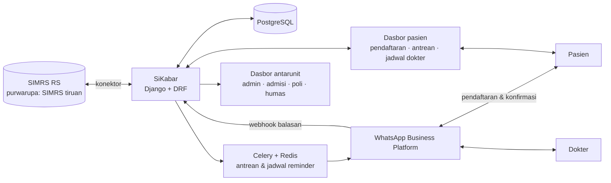

# Draf Proposal — RS-01 · Antech Async

<!-- nav:start -->
[◂ Semua proyek](../README.md) · **RS-01** · [README](README.md) · [1 Empathize](01-empathize.md) · [2 Define](02-define.md) · [3 Ideate](03-ideate.md) · [4 Prototype](04-prototype.md) · [5 Test](05-test.md) · [6 Implement](06-implement.md) · **Draf proposal**  
Referensi: [Mitra](../../docs/mitra/rs-ums-ar-fachrudin.md) · [Peran tim](../../docs/04-peran-tim.md) · [Template proposal](../../docs/03-template-proposal.md) · [Dokumen](../../docs/README.md)
<!-- nav:end -->

> Disusun dari file fase, [catatan-rapat-01.md](catatan-rapat-01.md), dan keputusan tim 19 Okt 2026. Ketentuan: [docs/03-template-proposal.md](../../docs/03-template-proposal.md).
> **Batas:** bag. 1–6 maks. 3 halaman (bag. 4 maks. 2, bag. 5 maks. 1) · pengajuan final s.d. **20 Okt 2026, 23.59 WIB**.
> Tim belum berkomunikasi langsung dengan mitra, jadi temuan ditulis sebagai sumber sekunder atau asumsi beserta rencana validasinya. Hapus semua tanda `[...]` sebelum dipindah ke template resmi.

## Identitas (untuk lembar identitas)

| Field | Isian |
|---|---|
| Nama tim | Antech Async |
| Judul inovasi | SiKabar: Sistem Notifikasi Dua Arah Perubahan Jadwal Dokter Berbasis WhatsApp untuk Layanan Rawat Jalan RS UMS A.R. Fachrudin |
| Kategori | Awal |
| Ketua | Purwo Setiawan (dosen) — [NIDN/NUPTK], [institusi] |
| Anggota | Reza (mahasiswa) — [NIM], [institusi] · Ridwan Renaldi (profesional) — [NIK], [institusi] · Muhammad Hammam Islami (profesional) — [NIK], [institusi] |
| Mitra · kode | RS UMS A.R. Fachrudin · RS-01 |

**Usulan nama sistem** (pilih satu, ganti di seluruh dokumen bila berubah):

| Nama | Alasan |
|---|---|
| **SiKabar** (dipakai di draf) | "Sistem Kabar Jadwal"; mengikuti pola nama sistem yang pernah dibuat tim (SIPAS, SIHRD) |
| JadwalPasti | Menonjolkan janji utama: pasien tahu pasti dokter praktik atau tidak |
| KabarPoli | Menonjolkan lingkup: poliklinik rawat jalan |

## 1. Judul Proposal

SiKabar: Sistem Notifikasi Dua Arah Perubahan Jadwal Dokter Berbasis WhatsApp untuk Layanan Rawat Jalan RS UMS A.R. Fachrudin

## 2. Tema Fokus Inovasi

- Bidang strategis: **Kesehatan**
- Tantangan: **RS-01 — Sistem Cerdas Manajemen Jadwal Dokter, Otomatisasi Notifikasi Pasien, dan Interoperabilitas Layanan RS**

## 3. Ringkasan Eksekutif

Jadwal praktik dokter spesialis di RS UMS A.R. Fachrudin kerap berubah mendadak karena dokter bertugas di fasilitas lain atau tertahan tindakan kegawatdaruratan, sedangkan pemberitahuan kepada pasien masih dilakukan manual melalui WhatsApp. SiKabar adalah sistem notifikasi dua arah berbasis WhatsApp Business Platform resmi yang menghubungkan dokter, pasien, dan petugas rumah sakit. Setiap perubahan status dokter, baik melalui balasan WhatsApp dokter maupun pembaruan administrator di dasbor, diteruskan otomatis kepada seluruh pasien pada sesi terkait beserta perkiraan jam praktik baru atau tawaran jadwal ulang. Pasien mendaftar melalui WhatsApp atau dasbor web dan dapat memantau antrean serta jadwal dokter di dasbor, sedangkan dokter cukup menerima satu rekapitulasi jumlah pasien. Sistem dikembangkan dengan Django dan disinkronkan dengan SIMRS. Target uji coba: sekurang-kurangnya 95% pesan terkirim dalam waktu kurang dari 1 menit, 80% pasien terkonfirmasi sebelum jam praktik, serta penurunan beban kerja admisi dan kedatangan pasien saat dokter berhalangan masing-masing sekurang-kurangnya 50%. Kegiatan meliputi validasi alur, pengembangan purwarupa saat *hackathon*, dan uji coba terbatas di 2–3 poliklinik hingga April 2027, dengan TKT awal 2 dan target TKT 6.

## 4. Deskripsi Inovasi

### 4.1 Masalah dan Pengguna

Perubahan jadwal praktik dokter spesialis terjadi hampir setiap hari, sementara pemberitahuan kepada pasien dilakukan manual melalui WhatsApp [sumber: laman tantangan, sosialisasi]. Jadwal pada situs rumah sakit hanya memuat pola mingguan tanpa status harian, dan pendaftaran daring masih berupa tautan WhatsApp [sumber: situs RS]. Akibatnya, rumah sakit tidak dapat mengabari seluruh pasien terdampak secara serentak dan tidak mengetahui pasien yang belum menerima informasi. Pengguna sistem adalah pasien rawat jalan, petugas admisi, perawat poliklinik, dokter spesialis, dan humas. Target mitra: notifikasi terkirim kurang dari 1 menit sejak status diperbarui, beban kerja admisi berkurang, serta pasien mudah mengonfirmasi atau menjadwal ulang kunjungan. Frekuensi perubahan jadwal belum diketahui [asumsi] dan akan diukur pada tahap validasi melalui anggota tim yang bekerja di RS UMS.

### 4.2 Solusi Awal

1. **Pengingat terjadwal.** Pasien menerima pengingat WhatsApp pada waktu yang ditetapkan administrator dan menjawab hadir atau batal. Pasien atau dokter yang tidak membalas dianggap hadir dan ditandai "belum konfirmasi". Apabila dokter belum mengonfirmasi hingga batas waktu tertentu (misalnya 60 menit sebelum praktik), perawat poliklinik menghubungi dokter secara langsung, dan selama itu pasien hanya menerima informasi "sesuai jadwal". Dokter menerima satu rekapitulasi jumlah pasien, bukan pesan per pasien; rekapitulasi terbaru dikirim hanya apabila jumlahnya berubah.
2. **Perubahan status dokter.** Dokter melaporkan keterlambatan atau ketidakhadiran melalui balasan WhatsApp, atau administrator memperbaruinya di dasbor. Apabila jam praktik terlewati dan dokter belum hadir, sistem meminta keputusan perpanjangan atau pembatalan sesi; pembatalan selalu ditetapkan oleh dokter atau administrator, tidak secara otomatis. Setiap perubahan langsung dikirim kepada seluruh pasien sesi tersebut beserta perkiraan jam baru atau tawaran jadwal ulang.

**Pendaftaran dan dasbor pasien.** Pendaftaran melalui WhatsApp atau dasbor web dicatat oleh SiKabar dan disinkronkan dengan SIMRS. Melalui dasbor, pasien dapat memantau nomor antrean yang sedang dilayani dan perubahan jadwal dokter secara waktu nyata.

**Teknologi.** Django dan Django REST Framework; Celery dan Redis untuk antrean pengiriman berbasis kejadian dan penjadwalan pengingat; PostgreSQL; WhatsApp Business Platform (pesan templat, tombol balasan, dan *webhook*); dasbor web waktu nyata; serta konektor SIMRS modular, dengan SIMRS tiruan pada tahap purwarupa.

**Kebaruan, kelayakan, dan kepatuhan.** Kebaruan SiKabar terletak pada alur dua arah yang diteruskan otomatis dan pemicu berbasis kejadian, bukan sekadar pengingat terjadwal. Kelayakan didukung pengalaman tim membangun SPADA UMS, SIPAS, SIHRD, APPLES, dan MyAudit. Sistem meminta persetujuan pasien dan tidak memuat informasi medis di dalam pesan, sesuai UU PDP dan KODERSI. Seluruh komponen dikembangkan oleh tim lokal dengan perangkat lunak sumber terbuka dan berpotensi didaftarkan sebagai hak cipta program komputer [ketentuan KI tantangan belum disebutkan; dikonfirmasi kepada panitia].

### 4.3 Kondisi Awal dan TKT

Capaian saat ini berupa analisis kebutuhan, rancangan alur, dan arsitektur sistem (Lampiran C); kode program belum dikembangkan. TKT awal adalah **2** (konsep telah dirumuskan), dengan target **TKT 4** pada akhir *hackathon* (fungsi inti berjalan dengan SIMRS tiruan) dan **TKT 6** pada April 2027 (diuji di rumah sakit). Indikator keberhasilan dibandingkan dengan kondisi awal:

| Kode | Indikator dan cara pengukuran | Target |
|---|---|---|
| M1 | Waktu dari perubahan status hingga pesan terkirim (log sistem) | ≥ 95% pesan < 1 menit |
| M2 | Persentase pasien yang membalas sebelum jam praktik | ≥ 80% |
| M3 | Menit kerja admisi untuk mengabari satu sesi | Turun ≥ 50% |
| M4 | Jumlah pasien yang datang saat sesi dibatalkan, per bulan | Turun ≥ 50% |
| M5 | Jumlah keluhan terkait jadwal yang diterima humas, per bulan | Turun dari kondisi awal |

### 4.4 Rencana Kegiatan

| Waktu | Kegiatan | Indikator keberhasilan |
|---|---|---|
| 26 Okt – 4 Nov 2026 | Validasi alur bersama admisi, poliklinik, humas, dan dokter; pengukuran kondisi awal | Alur disetujui mitra; data M3–M5 tercatat |
| Nov 2026 | Pengembangan purwarupa fungsi inti saat *hackathon* | M1 tercapai pada ≥ 20 uji pengiriman |
| Des 2026 | Konektor SIMRS dan akun WhatsApp Business resmi | Data pasien terbaca tanpa pengetikan ulang |
| Jan – Feb 2027 | Uji coba terbatas di 2–3 poliklinik | M1 dan M2 tercapai |
| Mar – Apr 2027 | Evaluasi, laporan akhir, rencana adopsi, dan pengajuan hak cipta | M3–M5 tercapai; kesepakatan adopsi |

### 4.5 Komposisi Tim

Tim lintas unsur terdiri atas dosen Teknik Industri, dua praktisi pengembang sistem informasi, dan mahasiswa yang bekerja di RS UMS; rincian peran disajikan pada bagian 5.

### 4.6 Dukungan Mitra

**Telah dinyatakan mitra** [sumber: laman tantangan]: diskusi kebutuhan bersama humas dan manajemen, penyediaan skenario kasus nyata, serta fasilitasi uji purwarupa di rumah sakit. **Direncanakan dan memerlukan persetujuan mitra:** akses data SIMRS, nomor WhatsApp Business rumah sakit, dan uji coba di 2–3 poliklinik.

## 5. Pembagian Tugas dan Tanggung Jawab

| Anggota | Peran | Tugas utama | Keluaran |
|---|---|---|---|
| Purwo Setiawan (dosen) | Ketua; koordinator operasional dan regulasi | Penghubung dengan panitia, pengendalian jadwal, analisis proses bisnis, kepatuhan UU PDP dan KODERSI, evaluasi M1–M5 | Rencana kegiatan, daftar periksa kepatuhan, laporan evaluasi |
| Ridwan Renaldi (profesional) | Koordinator teknis | Arsitektur dan *backend* Django, antrean notifikasi, integrasi WhatsApp, konektor SIMRS | Purwarupa, dokumentasi teknis, hasil uji fungsi |
| Muhammad Hammam Islami (profesional) | Koordinator bisnis dan hilirisasi; pendukung teknis | Model biaya, skema adopsi dan replikasi, pemetaan kekayaan intelektual, dasbor petugas dan pasien | Model bisnis, rencana hilirisasi, modul dasbor |
| Reza (mahasiswa) | Koordinator validasi pengguna; pendukung teknis | Koordinasi dengan admisi, poliklinik, dan humas; skenario uji; antarmuka dan templat pesan | Peta kebutuhan, hasil uji pengguna, templat pesan |

**Pemantauan kemajuan:** rapat mingguan (harian selama *hackathon*), papan tugas bersama yang memuat penanggung jawab dan tenggat, buku log kegiatan, serta tinjauan capaian oleh ketua pada akhir setiap tahap.

## 6. Daftar Pustaka

1. Republik Indonesia. (2022). *Undang-Undang Nomor 27 Tahun 2022 tentang Pelindungan Data Pribadi*.
2. Persatuan Rumah Sakit Seluruh Indonesia (PERSI). *Kode Etik Rumah Sakit Indonesia (KODERSI)*.
3. Meta. *WhatsApp Business Platform — Cloud API Documentation*. https://developers.facebook.com/docs/whatsapp/cloud-api
4. Gurol-Urganci, I., de Jongh, T., Vodopivec-Jamsek, V., Atun, R., & Car, J. (2013). Mobile phone messaging reminders for attendance at healthcare appointments. *Cochrane Database of Systematic Reviews*, (12), CD007458.

[Cek ulang setiap rujukan sebelum final; hapus yang tidak dikutip.]

---

## Lampiran C — Bukti desain awal (bahan)

Lampiran berisi tiga diagram. Render ke gambar sebelum dimasukkan ke PDF.

**C1. Arsitektur sistem**

**C2. Alur reminder terjadwal dan rekap dokter** — diagram A di [catatan-rapat-01.md](catatan-rapat-01.md#22-diagram-alur-diperbarui-sesuai-bagian-7).

**C3. Alur perubahan status dokter** — diagram B di file yang sama.

[Tambahkan mockup layar dashboard dan contoh pesan WhatsApp bila sempat.]

## Lampiran A dan B

- A: CV keempat anggota (format bebas) — lihat checklist anggota di Notion.
- B: Pakta integritas bertanda tangan keempat anggota (format template).

<!-- nav-bottom:start -->

---

◂ [6 Implement](06-implement.md) · [▴ Atas](#)  
Draf proposal di proyek lain: [ARB-01](../arb-01/proposal-draf.md) · [ARB-02](../arb-02/proposal-draf.md) · [LKPI-01](../lkpi-01/proposal-draf.md) · [LKPI-02](../lkpi-02/proposal-draf.md) · [UMS-01](../ums-01/proposal-draf.md) · [Template](../_template/proposal-draf.md)
<!-- nav-bottom:end -->
